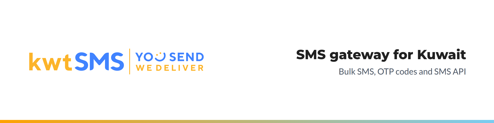

<picture>
  <source media="(prefers-color-scheme: dark)" srcset=".github/assets/readme-header-dark.png">
  
</picture>

# kwtsms-otp

[](https://github.com/kwtsms/kwtsms-otp/actions/workflows/ci.yml)
[](LICENSE)

SMS one-time codes (OTP) for Node, Bun and Cloudflare Workers, sent through kwtSMS, the Kuwaiti SMS gateway. One repo, two parts:

kwtSMS for developers: [kwtsms.com/developers.html](https://www.kwtsms.com/developers.html)

- `packages/core`: the npm package `kwtsms-otp`. `send` and `verify` with hashed codes, 3 attempts, cooldown, rate limits, country allowlist. Web APIs only.
- `starter/`: a small [Hono](https://hono.dev) app on top: `POST /otp/send`, `POST /otp/verify` and three English/Arabic screens. Runs on Node, Bun and Workers from one codebase.

## About kwtSMS

kwtSMS is a Kuwaiti SMS gateway trusted by top businesses to deliver messages anywhere in the world, with private Sender ID, free API testing, non-expiring credits, and competitive flat-rate pricing. Secure, simple to integrate, built to last. Open a free account in under 1 minute, no paperwork or payment required. [Click here to get started](https://www.kwtsms.com/cportal/signup/)

## Try it in 2 minutes (demo, no account)

```bash
git clone https://github.com/kwtsms/kwtsms-otp.git
cd kwtsms-otp
npm install && npm run build
npm start -w kwtsms-otp-starter          # Node 20+
# or: bun starter/src/bun.ts            # Bun
```

Open http://127.0.0.1:3000 and enter `50000000`. No credentials means **demo mode**: the code is shown on the page, nothing is sent, data is in memory.

## Go live

1. In your kwtSMS account open **API Integration > API Information** and note the API username and password (not your login).
2. Set `KWTSMS_USERNAME` and `KWTSMS_PASSWORD`. The app is now in **test mode**: real API calls with `test=1`, messages are queued, not delivered, and credits are held until you delete them from the Sending Queue.
3. Register your own private Sender ID in your account (approval takes time, start early) and set `KWTSMS_SENDER_ID`. The shared `KWT-SMS` is for testing only and is refused in live mode.
4. Set `DATABASE_URL` (for example `file:./data/otp.db`, or a Turso `libsql://` URL). Live mode refuses to start without it.
5. Set `KWTSMS_LIVE=1`. The app now sends real SMS and spends credits.

Cost: 1 credit per SMS part. The English text is ASCII and fits one part (160 characters); the Arabic text fits one part (70 characters). A longer `APP_NAME` is cut to 16 characters to keep it that way.

### Environment

| Variable | Default | Meaning |
| --- | --- | --- |
| `KWTSMS_USERNAME`, `KWTSMS_PASSWORD` | none | API credentials; none = demo mode |
| `KWTSMS_SENDER_ID` | `KWT-SMS` | your Sender ID (needed for live) |
| `KWTSMS_LIVE` | off | `1` = real delivery |
| `DATABASE_URL`, `DATABASE_AUTH_TOKEN` | memory | libSQL URL; required for live |
| `APP_NAME` | `App` | name in the SMS, ASCII, 16 characters |
| `ALLOWED_COUNTRIES` | `965` | comma list of country codes |
| `PER_PHONE_PER_HOUR`, `PER_IP_PER_HOUR`, `COOLDOWN_SECONDS`, `DAILY_CAP` | 5, 10, 60, 1000 | abuse limits; `DAILY_CAP=0` blocks all sends |
| `TRUST_PROXY` | off | `1` only behind your own proxy: reads the last `x-forwarded-for` entry |
| `HOST`, `PORT` | `127.0.0.1`, `3000` | listen address |

## Use cases

Same two endpoints, a `purpose` field picks the SMS text: `login`, `signup`, `phone` (confirm a number), `checkout` (confirm an order).

```bash
curl -s localhost:3000/otp/send -H 'content-type: application/json' -d '{"phone":"965XXXXXXXX","purpose":"checkout","lang":"en"}'
curl -s localhost:3000/otp/verify -H 'content-type: application/json' -d '{"phone":"965XXXXXXXX","code":"123456"}'
```

`/otp/send` answers `{"ok":true}` whether or not the SMS went out; errors are `INVALID_PHONE`, `COUNTRY_NOT_ALLOWED`, `COOLDOWN`, `LIMIT`. `/otp/verify` answers `{"ok":true,"phone":"965..."}` or `INVALID_OTP`, `OTP_EXPIRED`, `TOO_MANY_ATTEMPTS`. After a successful verify, start your own session: this repo does not manage sessions. For Better Auth, see [kwtsms-better-auth](https://github.com/kwtsms/kwtsms-better-auth).

## Use it in my existing app

Install `kwtsms-otp` and call `otp.send(req)` and `otp.verify(req)` from any handler. A full Express/Fastify style example is in [starter/examples/express.ts](starter/examples/express.ts); the Hono routes in [starter/src/app.ts](starter/src/app.ts) are 40 lines. API and options: [packages/core/README.md](packages/core/README.md).

## Runtimes

| Runtime | Entry | Notes |
| --- | --- | --- |
| Node 20, 22, 24 | `starter/src/node.ts` | `@hono/node-server`, client IP from the socket |
| Bun | `starter/src/bun.ts` | `Bun.serve`, client IP from `server.requestIP` |
| Cloudflare Workers | `starter/examples/worker.ts` | KV store, `cf-connecting-ip`. Typechecked in CI, not run in v0.1 |
| Deno | not in v0.1 | planned |

SQL store: `@libsql/client` runs on Node and Bun (tested in CI on both). On Workers use `KvStore`.

## Arabic (العربية)

ترسل هذه الحزمة رموز التحقق (OTP) عبر رسائل SMS من kwtSMS، وتعمل على Node وBun وCloudflare Workers. الشاشات بالعربية والإنجليزية، وتُختار العربية بالرابط `/?lang=ar`.

- بدون بيانات الدخول يعمل التطبيق بوضع العرض التجريبي: يظهر الرمز على الشاشة ولا تُرسل رسالة.
- مع `KWTSMS_USERNAME` و`KWTSMS_PASSWORD` يعمل بوضع التجربة: الرسالة تدخل طابور الارسال ولا تُسلّم، ويُحجز الرصيد حتى تحذفها من طابور الارسال.
- للإرسال الفعلي فعّل `KWTSMS_LIVE=1`. يلزم اسم المرسل الخاص بحسابك، ولا يُقبل اسم المرسل التجريبي `KWT-SMS`، كما يلزم `DATABASE_URL`.
- الرمز من 6 أرقام، صالح 5 دقائق، و3 محاولات فقط، ثم يلزم رمز جديد.
- يُقبل الرقم الكويتي من 8 أرقام، أو `+965`، أو `00965`، بالأرقام العربية أو الفارسية أو الإنجليزية.
- للدعم: https://www.kwtsms.com/support.html

## FAQ

**Why a database for live mode?** Codes, attempts and limits must survive a restart and be shared between instances. Live mode refuses the memory store.

**Does it work behind Cloudflare, Vercel or nginx?** Yes. Set `TRUST_PROXY=1` only if the proxy is yours and appends to `x-forwarded-for`; on Workers the app reads `cf-connecting-ip`. A wrong setting lets a bot rotate its IP.

**Where are the logs of a failed send?** Server console: the kwtSMS `ERR` code and a masked number. The code and the message text are never logged.

**Where do I find my API credentials and Sender ID?** In your kwtSMS account. Docs: https://www.kwtsms.com/api-documentation.html

## Support

- https://www.kwtsms.com/support.html
- https://www.kwtsms.com/api-documentation.html

## License

MIT, see [LICENSE](LICENSE).
